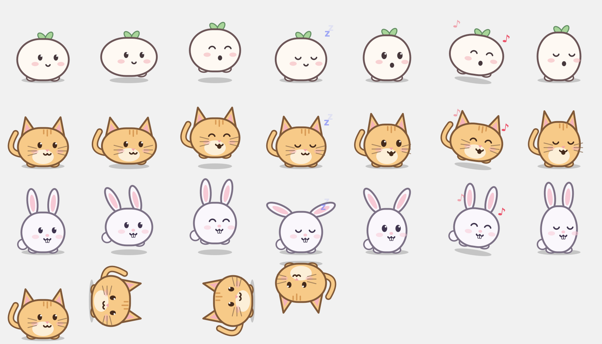

# Mochi 🍡

A tiny desktop pet for macOS. Pick a pet and it lives on your screen: it wanders along the Dock,
climbs the screen edges, hangs from the top, stands on your windows, says hi, and reacts when you
click, drag or ignore it.




There is no AI yet. Everything is rule-based, but the pet's decisions go through a single `Brain`
interface, so a smarter (LLM-powered) brain can be plugged in later without touching the rest.

## Pets

| Pet | Personality |
| --- | --- |
| **Mochi** 🍡 | Squishy and sleepy blob with a leaf sprout |
| **Miso** 🐱 | Curious, sneaky cat with a wagging tail |
| **Clover** 🐰 | Bouncy bunny whose ears flop when it sleeps |

Switch pets any time from the settings panel:


## Features

- **Lives on your whole screen**: walks the Dock, climbs the left and right edges, crawls along the
  top, and comes back down
- **Stands on your windows** and follows them when you move them; leaps up onto windows and hops off their edges
- **Drag and drop**: let go near a screen edge and it clings there; let go mid-screen and it falls onto a window or the Dock
- **Tricks**: yawn and stretch, spin, dance, look around, zoomies, nap (upside down on the ceiling if it likes)
- **Reacts to you**: eyes follow your cursor, it sometimes chases it, click to pet it (hearts!), poke it while it sleeps
- **Speech bubbles**: random hellos, time-of-day greetings and pet-specific lines (Silent / Quiet / Normal / Chatty)
- **Bring back to screen** button in case it ever wanders off
- Lightweight: native Swift and AppKit, no dependencies, no Dock icon, no special permissions

## Requirements

- macOS 13 (Ventura) or later
- Swift 5.9+ toolchain (Xcode 15+ or the Command Line Tools)

## Run it

```bash
git clone <repo-url>
cd Mochi
swift run
```

Or build a double-clickable app:

```bash
./scripts/build-app.sh
open dist/Mochi.app
```

The build is ad-hoc signed, so on first launch macOS may ask you to right-click the app and choose
**Open**. Mochi lives in the menu bar (🍡 / 🐱 / 🐰); there is no Dock icon.

## Controls

| Action | What happens |
| --- | --- |
| Click the pet | Pets it (hearts and a happy hop) |
| Drag and drop | Pick it up; let go near an edge to make it cling |
| Right-click the pet or click the menu bar icon | Say hi, pet, come here, do a trick, sleep, bring back, settings, quit |
| `⌘ ,` / `⌘ B` (menu open) | Open settings / bring the pet back |

## How it works

The pet's position is tracked as the centre of a small transparent, borderless, always-on-top window.
Each tick (30 fps) it is attached to a **surface**: the floor (Dock or a window top), a side wall, the
ceiling, or in the air (falling). Walking along a surface and turning corners is handled in
`PetController`. Window tops are found with `CGWindowListCopyWindowInfo`, which only reads window
frames, so no Screen Recording or Accessibility permission is needed.

```
Sources/Mochi
├── main.swift             entry point
├── AppDelegate.swift      menu bar + right-click menu
├── PetController.swift    window, 30fps loop, surfaces, physics, behaviour
├── Brain.swift            PetAction, Brain protocol, RuleBrain (swap in AI here)
├── PetView.swift          drawing for every pet and mood, mouse input
├── Species.swift          pet definitions (colours, speed, lines)
├── Dialogue.swift         everything the pet says
├── SpeechBubble.swift     the speech bubble window
├── Platform.swift         finds window tops to stand on
├── PetSettings.swift      saved preferences (UserDefaults)
├── SettingsView.swift     SwiftUI settings panel
└── Render.swift           `Mochi --render out.png` writes a preview sheet
```

## Make it your own

**Add a new pet:** add a case to `Species` (name, colours, speed, lines), then add its drawing branch in
`PetView` (body size, ears/tail, face extras). Check how it looks without running the app:

```bash
swift run Mochi --render preview.png
```

**Add a new action:** add a case to `PetAction` in `Brain.swift`, give it a weight in `RuleBrain`, and handle it in
`PetController.behave` (and a `Mood` in `PetView` if it needs a new pose).

**Add AI:** implement the `Brain` protocol:

```swift
struct LLMBrain: Brain {
    func nextDecision(_ ctx: PetContext) -> Decision { /* ask a model, return an action */ }
}
```

then pass it to `PetController(brain:)`.

## Roadmap

- [ ] AI brain that chats and decides what to do
- [ ] More pets and more tricks (play with a ball, react to music)
- [ ] Multi-monitor roaming
- [ ] Launch at login

## Contributing

Issues and pull requests are welcome. See [CONTRIBUTING.md](CONTRIBUTING.md).

## License

[MIT](LICENSE)
