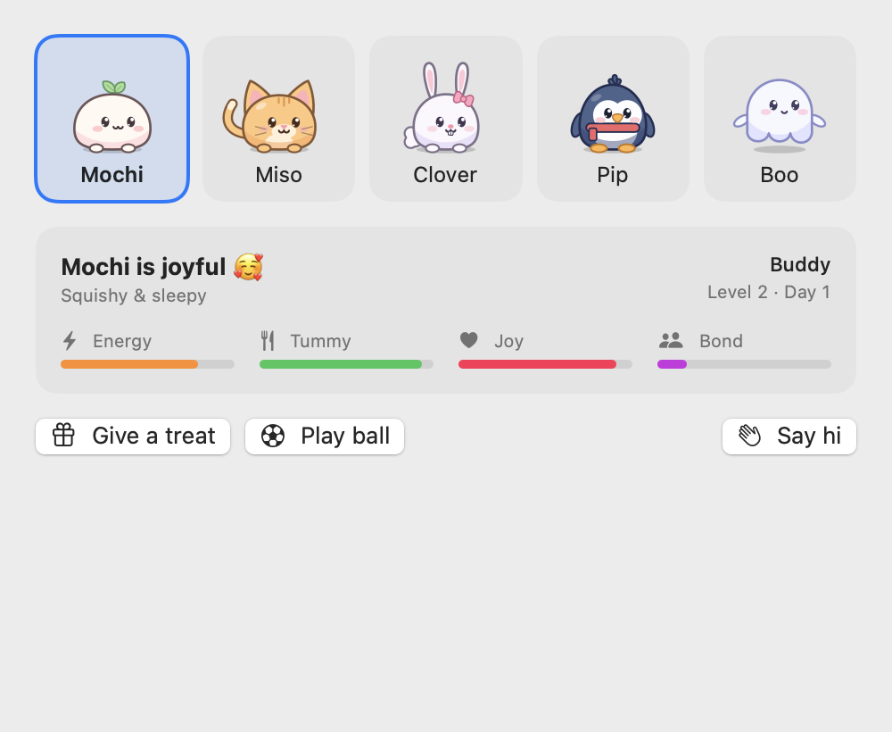

# Mochi 🍡

A tiny desktop pet for macOS. Pick one of five pets and it lives on your screen: it wanders along the Dock,
climbs the screen edges, hangs from the top, stands on your windows, says hi, and reacts when you
click, drag or ignore it.


Each pet has a little mind of its own: it gets tired, hungry and lonely, has its own personality, and
grows closer to you the more you look after it. There is no AI model involved. Everything is rule-based
and runs offline, but the pet's decisions go through a single `Brain` interface, so a smarter
(LLM-powered) brain can be plugged in later without touching the rest.

## Pets

| Pet | Personality |
| --- | --- |
| **Mochi** 🍡 | Squishy and sleepy blob with a leaf sprout. Naps a lot and loves company |
| **Miso** 🐱 | Curious, sneaky cat with a wagging tail and whiskers. Explores and climbs, not very clingy |
| **Clover** 🐰 | Bouncy bunny with a pink bow whose ears flop when it sleeps. The most playful of the lot |
| **Pip** 🐧 | Waddly, dapper penguin with a feather tuft and a red scarf who flaps when happy. Always hungry |
| **Boo** 👻 | Floaty, friendly ghost with a wavy hem. Barely sleeps or eats |

Switch pets any time from the Pet tab in settings:



## Features

**Has a mind of its own**
- **Needs**: energy, tummy and joy drift over time. A tired pet naps, a hungry one sulks and asks for its favourite snack, a lonely one comes looking for you, and a happy one dances and gets the zoomies
- **Personality**: every pet weighs its choices differently (see the table above)
- **Bond**: petting, treats, playing and focus sessions grow your friendship from *New friend* to *Soulmate*; closer pets follow you more and say fonder things
- **Memory**: it remembers all of this between launches, rests while the app is closed, and misses you when you've been gone
- See how it's doing at the top of the menu and in the settings panel

**Moves around your whole screen**
- Walks the Dock, **climbs the left and right edges**, crawls along the top, and comes back down
- Sometimes decides on its own to head for an edge and climb; its grip is strong, but after a long time hanging around it may slip and fall
- Stands on top of your windows (and follows them), leaps up onto windows and hops off their edges
- Drag and drop: let go near a screen edge and it clings there; let go mid-screen and it falls onto a window or the Dock
- Stays stable when you swipe between Spaces and shows up over full-screen apps

**Reacts to what is happening on your Mac** (no special permissions)
- **Music** (Spotify, Apple Music, ...): puts on headphones, bobs to the beat and dances, but only while music is actually playing (a paused Spotify doesn't count; it learns the state at the next play, pause or track change)
- **Videos** (QuickTime, VLC, IINA, ...): settles down to watch ("Movie time! 🍿")
- **Calls** (Zoom, Teams, FaceTime, Discord, ...): goes quiet and still
- **Anything else making sound** (browsers, etc.): bobs along and sometimes dances
- **Typing**: bops along with every key you press and cheers when you're on a roll or typing fast. It only reads the system's running count of key presses, never which keys
- Falls asleep when you step away, and welcomes you back when you return
- Reminds you to stretch after about 50 minutes of work, comments on low battery, plugging in and mealtimes

**Interacts with you**
- Eyes follow your cursor; it sometimes chases it and looks at you when you are near
- Click to pet it (hearts!), click fast to make it blush, poke it while it sleeps
- Hover over it for a moment and it perks up
- **Give a treat**: a snack drops from the top of the screen and the pet runs over to eat it
- **Play ball**: drop a toy and the pet chases it along the Dock and kicks it back into the air
- **Focus session** (15, 25 or 50 minutes): the pet keeps quiet and calm while you work, then celebrates with you
- **Shake your mouse** at it and it gets dizzy
- Tricks: yawn and stretch, spin, dance, look around, zoomies, nap
- Speech bubbles: random hellos, time-of-day greetings and pet-specific lines (Silent / Quiet / Normal / Chatty)
- **Bring back to screen** button in case it ever wanders off
- **Launch at login** (when run from the built `Mochi.app`)
- **Three sizes**: Small, Medium (default) and Large

Lightweight: native Swift and AppKit, no dependencies, no Dock icon.

## Requirements

- macOS 13 (Ventura) or later
- Swift 5.9+ toolchain (Xcode 15+ or the Command Line Tools)

## Run it

```bash
git clone <repo-url>
cd Mochi
swift run
```

Or build a double-clickable app:

```bash
./scripts/build-app.sh
open dist/Mochi.app
```

The build is ad-hoc signed, so on first launch macOS may ask you to right-click the app and choose
**Open**. Mochi lives in the menu bar (the icon matches your pet); there is no Dock icon.

## Controls

| Action | What happens |
| --- | --- |
| Click the pet | Pets it (hearts and a happy hop) |
| Drag and drop | Pick it up; let go near an edge to make it cling |
| Right-click the pet or click the menu bar icon | A status card, then Give a Treat, Play Ball, Interact (say hi, pet, come here, trick, sleep), Focus Session, Bring Back, Settings, Quit |
| Settings | **Pet**: choose a pet and see how it's doing. **Behavior**: what it's allowed to do and react to. **General**: size, speech bubbles, launch at login |
| `⌘ ,` / `⌘ B` (menu open) | Open settings / bring the pet back |

## How it works

The pet's position is tracked as the centre of a small transparent, borderless, always-on-top window.
Each tick (30 fps) it is attached to a **surface**: the floor (Dock or a window top), a side wall, the
ceiling, or in the air (falling). Walking along a surface and turning corners is handled in
`PetController`. Window tops are found with `CGWindowListCopyWindowInfo`, which only reads window
frames, so no Screen Recording or Accessibility permission is needed.

```
Sources/Mochi
├── main.swift             entry point
├── AppDelegate.swift      menu bar + right-click menu
├── PetController.swift    window, 30fps loop, surfaces, physics, reactions
├── Brain.swift            PetAction, Brain protocol, MindBrain (swap in AI here)
├── Mind.swift             the pet's needs, bond and memory (saved between launches)
├── PetView.swift          drawing for every pet and mood, mouse input
├── Species.swift          pet definitions (colours, speed, lines)
├── Dialogue.swift         everything the pet says
├── SpeechBubble.swift     the speech bubble window
├── Platform.swift         finds window tops to stand on
├── AudioWatcher.swift     notices which apps are playing sound (music / video / call)
├── SystemInfo.swift       idle time, battery and the key press count
├── Treat.swift            the snack and the ball you can drop for the pet
├── LoginItem.swift        launch at login
├── PetSettings.swift      saved preferences (UserDefaults)
├── SettingsView.swift     SwiftUI settings panel
└── Render.swift           `Mochi --render out.png` writes a preview sheet
```

## Make it your own

**Add a new pet:** add a case to `Species` (name, colours, speed, lines), then add its drawing branch in
`PetView` (body shape, limbs, face extras). Check how it looks without running the app:

```bash
swift run Mochi --render preview.png
```

**Add a new action:** add a case to `PetAction` in `Brain.swift`, give it a weight in `MindBrain`, and handle it in
`PetController.behave` (and a `Mood` in `PetView` if it needs a new pose).

**Add AI:** implement the `Brain` protocol:

```swift
struct LLMBrain: Brain {
    func nextDecision(_ ctx: PetContext) -> Decision { /* ask a model, return an action */ }
}
```

then pass it to `PetController(brain:)`.

## Roadmap

- [ ] AI brain that chats and decides what to do
- [ ] Real beat detection (needs audio-capture permission)
- [ ] More pets and more tricks (hide and peek)
- [ ] Multi-monitor roaming

## Contributing

Issues and pull requests are welcome. See [CONTRIBUTING.md](CONTRIBUTING.md).

## License

[MIT](LICENSE)
